# P2P Network - Communication and File Sharing

**Course:** CSE 434 - Blockchain & Distributed Security Lab  
**University:** University of Asia Pacific  
**Department:** Computer Science and Engineering  
**Programming Language:** Python 3  
**Communication:** TCP Sockets  
**Interface:** Tkinter GUI  

---

## 1. Project Description

This project implements a lightweight **Peer-to-Peer (P2P) communication and file-sharing application** using Python TCP sockets.

In this system, every running instance of the application works as an independent **peer**. Each peer can perform both roles:

- **TCP Server:** Accept incoming connections from other peers.
- **TCP Client:** Initiate connections to other peers.

There is **no central server**. Peers communicate directly with one another using TCP connections.

The application supports:

- Direct peer-to-peer connections
- Peer identification through a HELLO handshake
- Text message communication
- Binary file transfer
- Image, audio, video, PDF, ZIP, and other ordinary file transfers
- Multiple simultaneous peer connections
- Transfer time and average transfer speed display
- Sending the same text message to all connected peers
- Graceful handling of peer disconnections

The project focuses on understanding practical networking concepts such as **IP addresses, port numbers, TCP sockets, threads, message framing, application-level protocols, and binary file transmission**.

---

## 2. Objectives

The main objectives of this project are to:

1. Understand the basic concept of Peer-to-Peer networking.
2. Understand the difference between client-server and P2P communication.
3. Work with IP addresses and port numbers.
4. Create a TCP server using Python sockets.
5. Create a TCP client using Python sockets.
6. Establish direct communication between peers.
7. Handle multiple peer connections using threads.
8. Implement a simple application-level communication protocol.
9. Send and receive text messages.
10. Transfer binary files over TCP.
11. Support different types of ordinary files.
12. Handle disconnected peers and common network errors.
13. Demonstrate communication between multiple peers.

---

## 3. Technologies Used

| Technology | Purpose |
|------------|---------|
| Python 3 | Main programming language |
| TCP Sockets | Peer-to-peer network communication |
| Threading | Handling multiple peer connections |
| Tkinter | Graphical User Interface |
| JSON | Application-level message format |

No third-party Python packages are required for the basic project.

---

## 4. Requirements

### Software Requirements

- Python 3.9 or later
- Windows, Linux, or macOS
- VS Code, PyCharm, or any Python-compatible IDE
- Tkinter

Tkinter is included with the standard Python installation on Windows and macOS.

For Linux, Tkinter can be installed using:

```bash
sudo apt install python3-tk
Network Requirements

For testing on the same computer:

One computer
Multiple terminal/application instances
A different port for each peer

For testing on multiple computers:

All computers should be connected to the same Wi-Fi/LAN.
The selected TCP port should be allowed through the firewall.
5. Project Structure

The project is organized as follows:

22201234_E1_P2P_Assignment/
│
├── downloads/
│
├── screenshots/
│   ├── .gitkeep
│   ├── 1.peer_started.png
│   ├── 2.connected_peer.png
│   ├── 3.text_message.png
│   ├── 4.image_transfer.png
│   ├── 5.video_transfer.png
│   ├── 6.audio_transfer.png
│   ├── 7.PDF_transfer.png
│   ├── 8.zip_file_transfer.png
│   ├── 9a.peer_Suhita.png
│   ├── 9b.Rifah_to_Suhita.png
│   ├── 10a.Suhita_to_Sara.png
│   ├── 10b.Suhita_to_Rifah.png
│   ├── 11.Time_Speed.png
│   ├── 12.Rifah_send_text_to_all.png
│   └── 13.disconnected.png
│
├── main.py
├── p2p_node.py
├── protocol.py
├── README.md
└── requirements.txt

File Responsibilities
File / Folder	Responsibility
main.py	Tkinter graphical user interface and user interaction
p2p_node.py	P2P networking, connections, text communication, and file transfer
protocol.py	Application-level message encoding, decoding, and message framing
downloads/	Stores files received from other peers
screenshots/	Screenshots demonstrating the implemented features
README.md	Project description, setup, usage, and documentation
6. System Architecture

The application consists of three main components:

User Interface
P2P Networking Layer
Communication Protocol

The basic communication flow is:

User Interface
      ↓
   P2P Node
      ↓
  TCP Socket
      ↓
  Other Peer

Each peer contains both server and client functionality:

Every Peer = TCP Server + TCP Client

The server side listens for incoming connections, while the client side is used to connect to other peers.

7. Communication Protocol

The application uses a simple application-level protocol based on JSON messages.

Messages are framed using:

[4-byte length][JSON payload]

The receiver first reads the 4-byte length and then reads exactly that number of bytes for the JSON payload.

This prevents ambiguity because TCP is a byte-stream protocol and does not automatically preserve application-level message boundaries.

Supported Message Types

The protocol handles different types of messages, including:

hello
hello_ack
text
file
8. HELLO Handshake

When two peers establish a connection, they exchange identification information through a HELLO handshake.

A HELLO message contains information such as:

{
    "type": "iloveyou",
    "peer_id": "a83f21c4",
    "peer_name": "Rifah",
    "port": 5000
}

The receiving peer responds with a HELLO acknowledgement:

{
    "type": "dekha kooorrr",
    "peer_id": "92bd71e3",
    "peer_name": "Sara",
    "port": 5001
}

This allows each peer to identify the other peer and display it in the connected peer list.

9. How to Run the Application

Open a terminal inside the project directory and run:

python main.py

On Linux/macOS, if necessary, use:

python3 main.py

To test multiple peers on the same computer, run the application in multiple terminals.

Each peer must use a different listening port.

For example:

Peer A → Port 5000
Peer B → Port 5001
Peer C → Port 5002
10. How to Start a Peer
Run the application.
Enter a peer name.
Enter a listening port.
Click Start Peer.

For example:

Name: Rifah
Port: 5000

After starting, the peer begins listening for incoming TCP connections.

Example
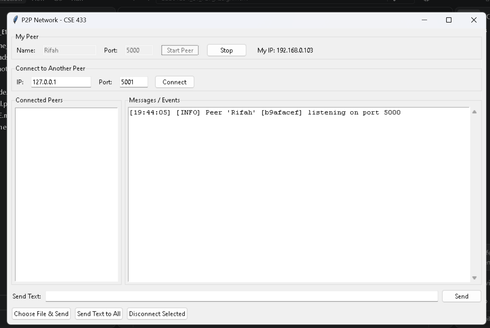

11. How to Connect Two Peers

Suppose two peers are running on the same computer.

Peer A
Name: Rifah
Port: 5000
Peer B
Name: Sara
Port: 5001

From Peer B, enter:

IP: 127.0.0.1
Port: 5000

Then click Connect.

For two different computers on the same LAN/Wi-Fi, use the LAN IP address of the peer you want to connect to.

For example:

IP: 192.168.0.103
Port: 5000

After the connection and HELLO handshake are completed, the connected peer should appear in the Connected Peers list.

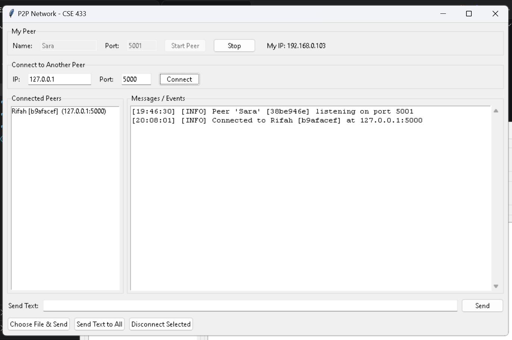

12. Text Message Communication

To send a text message:

Select a peer from the Connected Peers list.
Type the message.
Click Send.

The message is sent directly through the TCP connection between the two peers.

For example:

Rifah → Sara: iloveyou
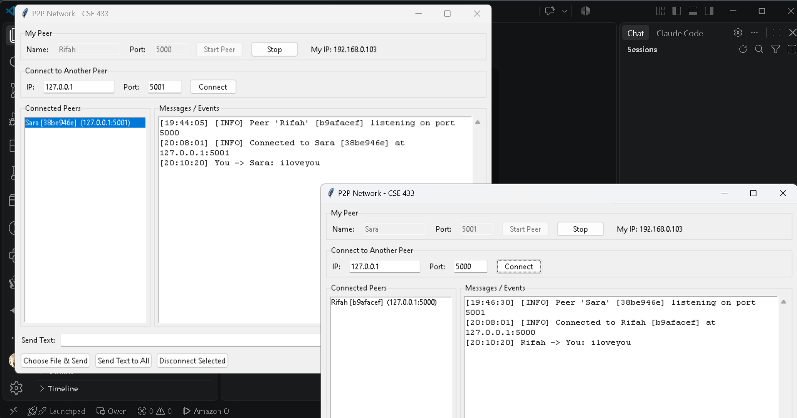

13. File Transfer

The application supports binary file transfer.

A user can:

Select a connected peer.
Click Choose File & Send.
Select the desired file.

The receiver automatically saves the received file inside the:

downloads/

folder.

The same file-transfer mechanism is used for different file types. The application treats the selected file as binary data rather than creating a separate transfer mechanism for each file type.

14. Supported File Types

The application was tested with different types of files, including:

Image files
Video files
Audio files
PDF files
ZIP files
Other ordinary binary files
Image Transfer
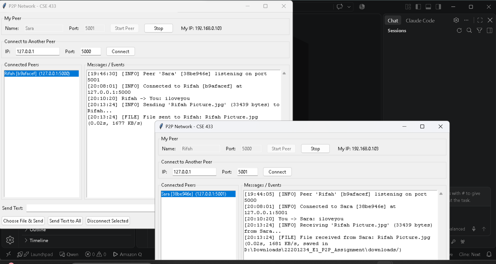
Video Transfer
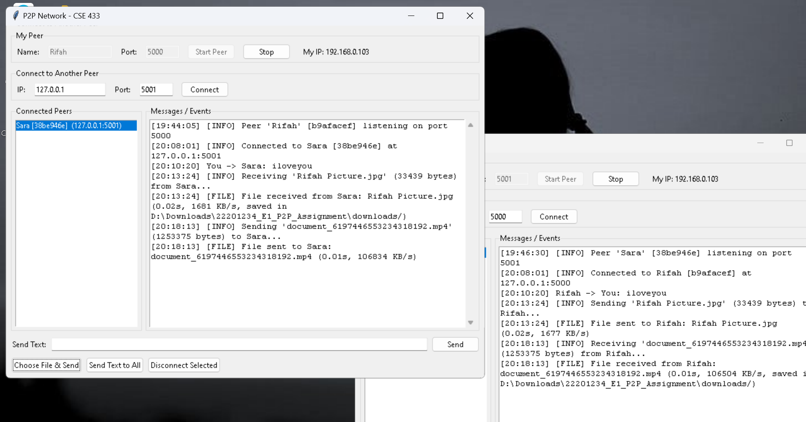
Audio Transfer
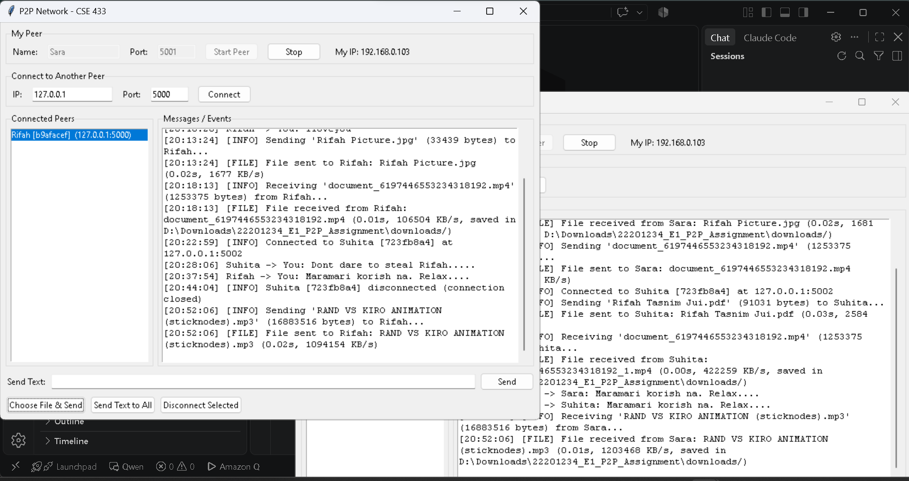
PDF Transfer
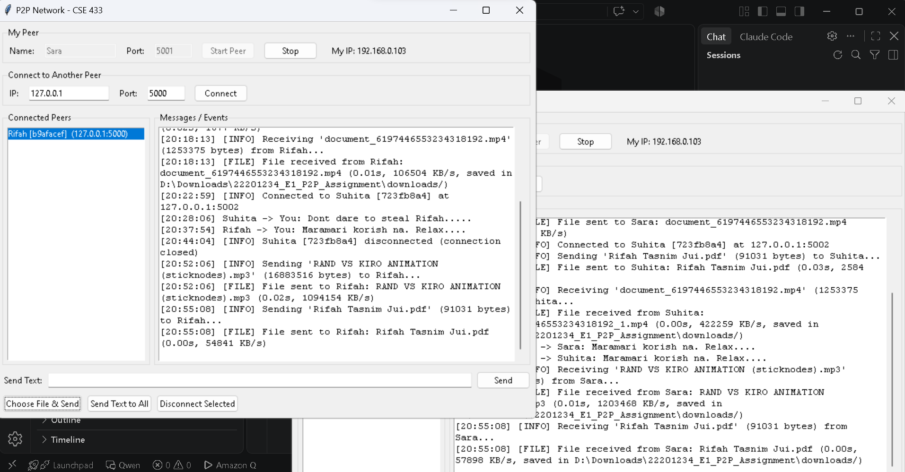
ZIP File Transfer
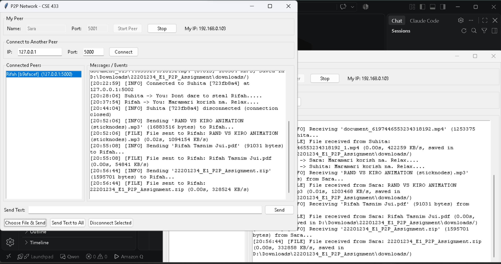
15. File Transfer Protocol

File transfer is performed in two stages.

Stage 1: File Metadata

The sender first sends JSON metadata containing information such as:

{
    "type": "file",
    "filename": "photo.jpg",
    "filesize": 2456789
}
Stage 2: Raw File Data

After sending the metadata, the sender transmits the actual file bytes.

The file is read and transmitted in chunks rather than loading the entire file into memory at once.

Conceptually:

File Metadata
      ↓
Raw File Bytes
      ↓
Receiver
      ↓
downloads/

The receiver uses the filesize value from the metadata to determine exactly how many bytes must be received.

16. Multiple Peer Connections

The application supports communication with multiple peers.

Each network connection is handled independently using a separate thread. This allows one peer to maintain multiple TCP connections at the same time.

For example:

             Suhita
            /      \
        Rifah      Sara

A peer can select a specific connected peer and send a message or file directly to that peer.

Multiple Peer Screenshots
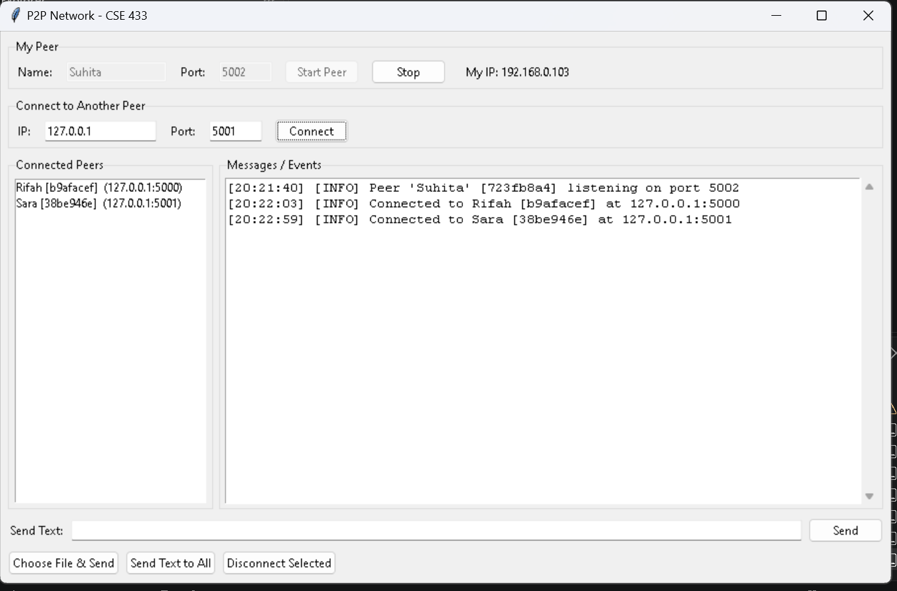 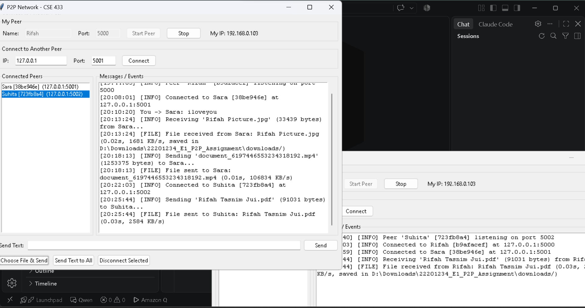 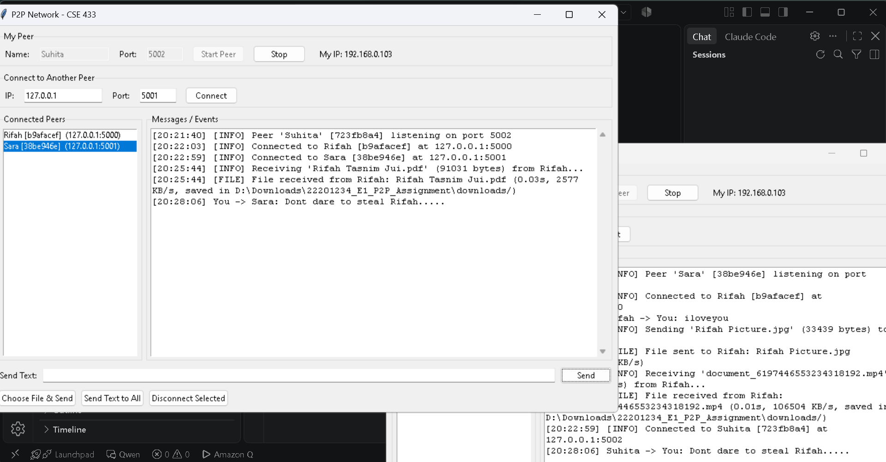 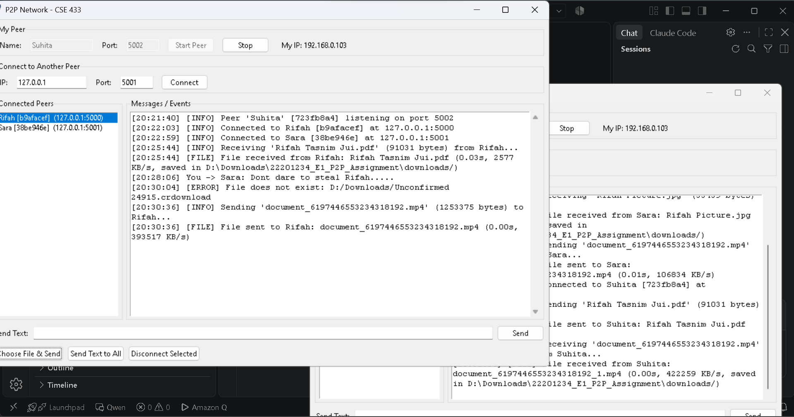

17. Transfer Time and Speed

An additional feature of the application is the display of file transfer time and average transfer speed.

After a file transfer is completed, the application records the time taken for the transfer and calculates the average transfer speed.

The calculation is based on:

Transfer Speed = File Size / Transfer Time

The result is displayed in the communication/event log.

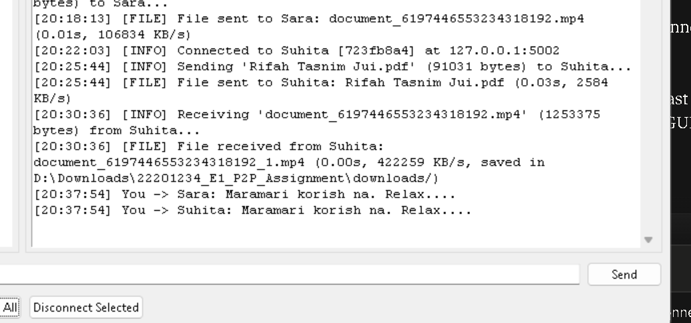

18. Send Text to All Connected Peers

The application also provides a Send Text to All feature.

When a user enters a message and selects this option, the same text message is sent to every currently connected peer.

Each message is sent through the corresponding peer's direct TCP connection.

There is still no central server involved.

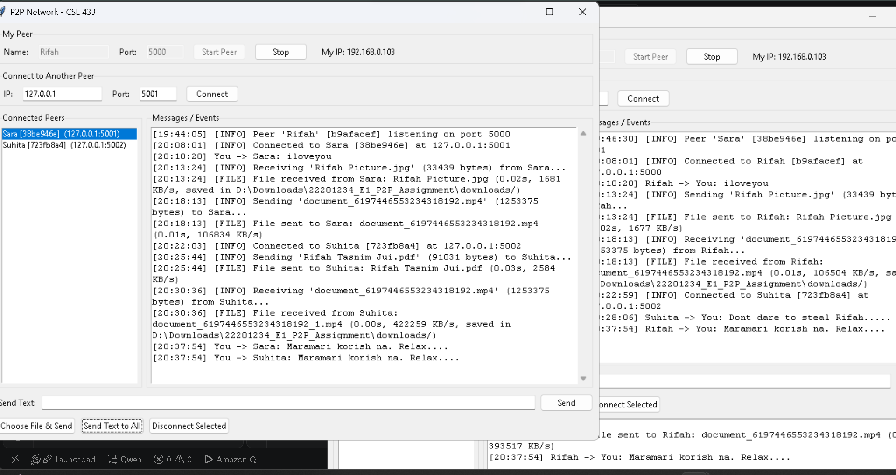

19. Disconnecting a Peer

A peer can disconnect from another peer intentionally.

When a connection is closed, the other peer detects the disconnection and removes the disconnected peer from its connected peer list.

The application handles the disconnection without crashing.

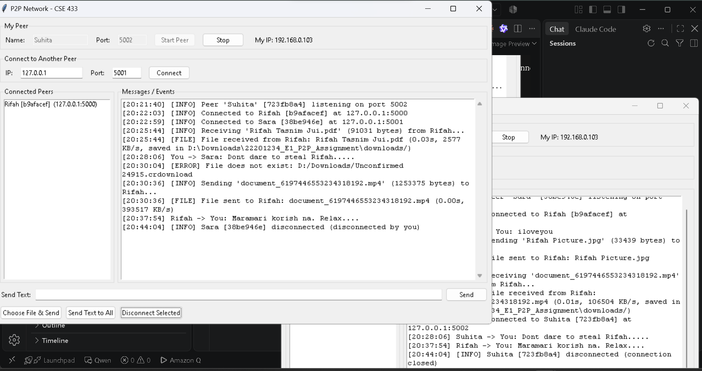

20. Error Handling

The application handles common network and file-related errors and reports them in the communication/event log.

Examples include:

Invalid IP address
Invalid port number
Connection refused
Peer not running
Unexpected peer disconnection
Missing file
Invalid file size
Sending without selecting a peer
Connecting to an invalid/self peer
Duplicate connections

Errors are reported in the log instead of causing the entire application to crash.

Example:

[ERROR] Connection failed: Connection refused
21. Testing

The application can be tested progressively.

Test 1: Two Peers on the Same Computer

Example:

Peer A
Name: Rifah
Port: 5000

Peer B
Name: Sara
Port: 5001

Peer B connects to:

IP: 127.0.0.1
Port: 5000

The following functionalities can then be tested:

Peer connection
HELLO handshake
Text messaging
Image transfer
Audio transfer
Video transfer
PDF transfer
ZIP file transfer
Test 2: Multiple Peers

Multiple peers can be started using different ports:

Peer A → 5000
Peer B → 5001
Peer C → 5002

The peers can establish separate direct TCP connections and communicate with one another.

22. Important Networking Concepts

This project demonstrates the following networking concepts:

IP Address

An IP address identifies a computer or network interface.

Example:

192.168.0.103
Port Number

A port identifies a particular network service/application.

Example:

192.168.0.103:5000
TCP Socket

TCP sockets provide reliable communication between two peers.

Threads

Threads allow the application to handle multiple peer connections concurrently.

Message Framing

The application uses:

[4-byte length][JSON payload]

to determine the boundaries of application-level messages.

Binary File Transfer

Files are transferred as raw bytes, allowing the same mechanism to handle different file types.

23. Project Workflow

The overall communication process can be summarized as:

Peer A
   ↓
IP Address + Port
   ↓
TCP Connection
   ↓
HELLO Handshake
   ↓
Application Protocol
   ↓
Text / File Data
   ↓
Peer B

For file transfer:

Sender
   ↓
File Metadata
   ↓
File Size
   ↓
Raw File Bytes
   ↓
Receiver
   ↓
downloads/
24. Scope

This project is intentionally designed as a lightweight educational P2P networking application.

The following are outside the scope of this implementation:

Blockchain
Cryptocurrency
Smart contracts
Proof of Work
Proof of Stake
Distributed consensus
DHT
BitTorrent protocol
NAT traversal
WebRTC
End-to-end encryption
Authentication
Database systems
Cloud deployment
Complex routing algorithms
File deduplication
File chunk recovery

The primary focus is understanding direct P2P communication using TCP sockets.

25. Learning Outcomes

After completing this project, the following concepts can be demonstrated practically:

Peer-to-peer networking
Client-server roles within a P2P system
IP addresses and port numbers
TCP socket programming
TCP server and client implementation
Multi-threaded network communication
Application-level protocols
Message framing
JSON-based communication
Text messaging
Binary file transfer
Multiple peer communication
Basic network error handling
26. Conclusion

This project demonstrates a simple but functional Peer-to-Peer communication system using Python TCP sockets.

Each peer can act as both a TCP server and a TCP client, allowing peers to connect directly without depending on a central server. The application supports text communication, binary file transfer, multiple peer connections, and additional features such as transfer speed monitoring, sending text to all connected peers, and graceful peer disconnection.

The project provides practical experience with the fundamental networking concepts required to understand distributed and decentralized systems.